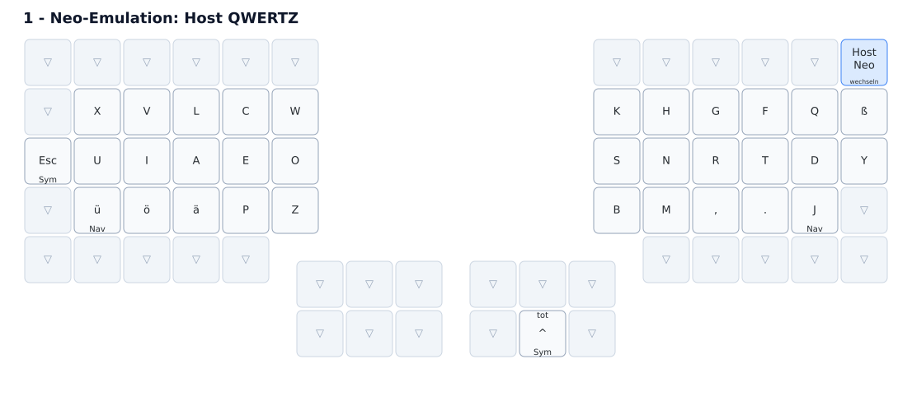
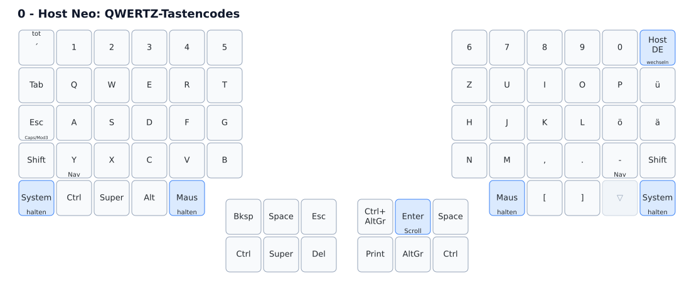
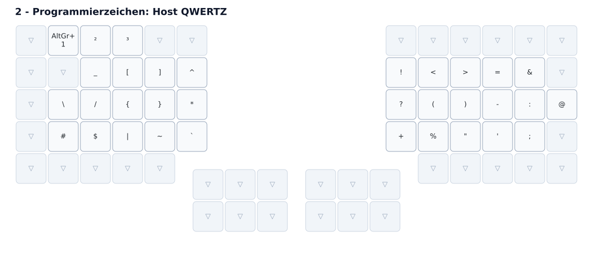
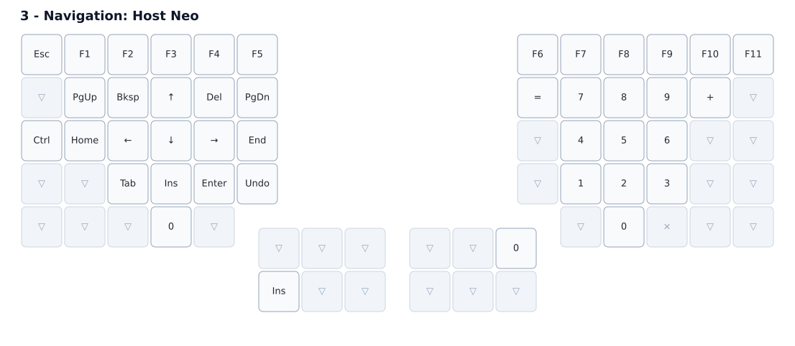
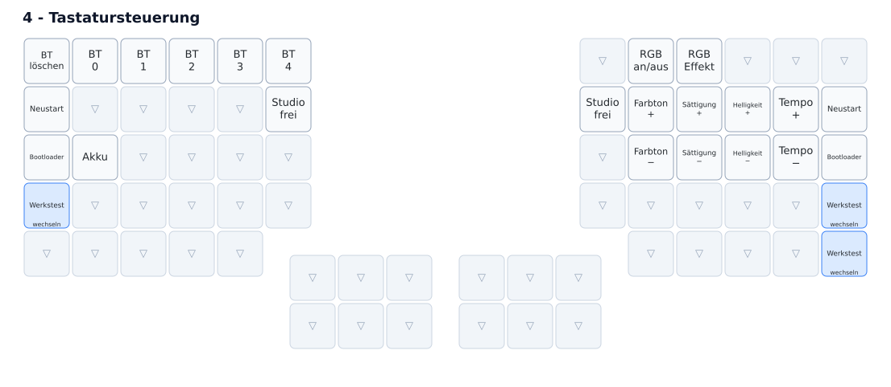
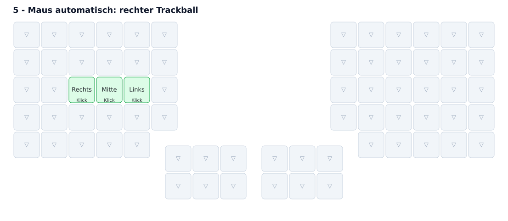
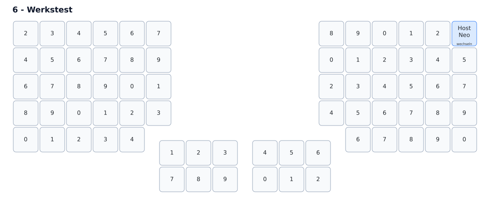
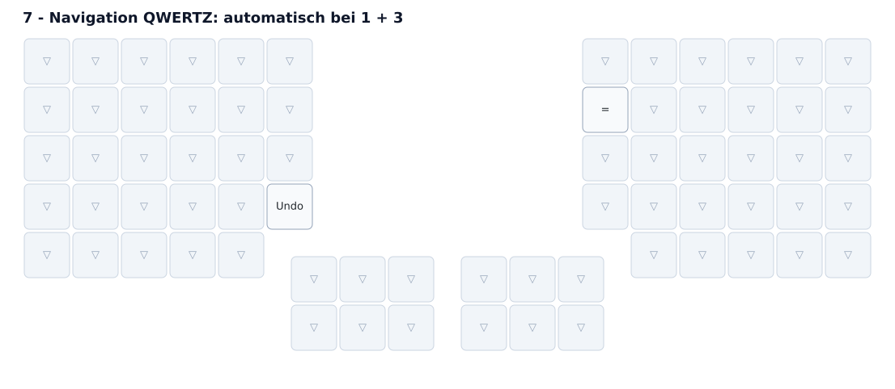
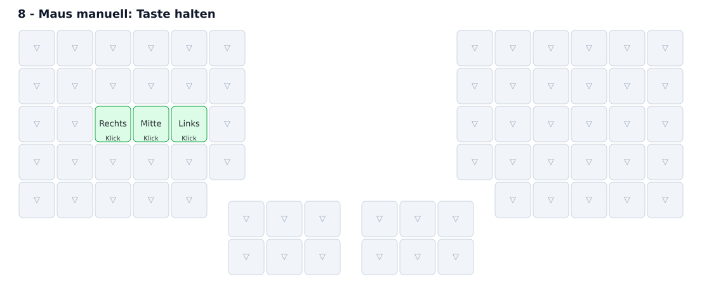
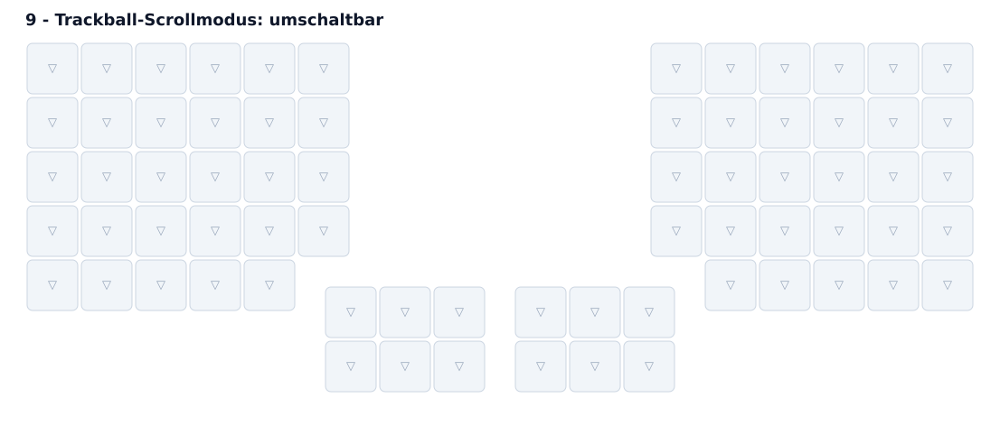

# Cyboard Imprint: Neo und QWERTZ

Die Taste ganz rechts in der Zahlenreihe wechselt zwischen den beiden Modi.
Sie ändert die Firmware-Belegung, nicht das Layout im Betriebssystem.

| Firmware-Ebene | Layout am Rechner | Verwendung |
| --- | --- | --- |
| `Qwertz` (0, grün beim Umschalten) | Neo unter Linux | Das Betriebssystem erzeugt die Neo-Zeichen. |
| `NEO_Layout` (1, blau beim Umschalten) | Deutsch/QWERTZ | Die Firmware bildet Neo-Buchstaben und Programmierzeichen nach. |

Die Farbmarkierung setzt eingeschaltete RGB-Beleuchtung voraus. Ebene 0 kann
auch zum normalen QWERTZ-Tippen verwendet werden; ihre Navigationstasten `=`
und Undo sind jedoch auf den privaten Linux-Neo-Host abgestimmt.

## Akkustand auf den LEDs

Die äußere linke `System`-Taste in der unteren Fingerreihe halten und die Taste
direkt rechts neben `Caps/Esc` drücken. Beide Hälften zeigen dann **vier Sekunden
lang ihren eigenen Akkustand**: Die ersten zehn LEDs bilden einen Balken in
10-%-Schritten. Rot bedeutet höchstens 20 %, Gelb höchstens 50 %, sonst Grün.
Bei 0 % leuchtet eine rote LED, damit die Anzeige erkennbar bleibt. Danach
kehrt die Beleuchtung zu ihrer vorherigen Einstellung zurück, auch wenn sie
zuvor ausgeschaltet war. Beide Hälften müssen verbunden sein und die neue
Firmware tragen.

## Layout und Ebenen

Die Grafiken werden aus [`config/imprint.keymap`](config/imprint.keymap) und
den 70 Tastenpositionen in [`config/info.json`](config/info.json) erzeugt.
Sie zeigen eine schematische Draufsicht mit den Daumenclustern unten in der
Mitte. Der einzige Trackball sitzt rechts und gehört nicht zur Tastenmatrix.

**Legende:** Bei Tasten mit Doppelfunktion steht die Tippfunktion mittig und
die Haltefunktion unten. `Nav` bedeutet Navigation, `Sym` Programmierzeichen,
`System` Tastatursteuerung, `Maus` die manuelle Mausebene. Blau markiert
Ebenenwechsel, Grün Maustasten. `▽` reicht an die darunterliegende aktive
Ebene durch; `×` blockiert die Taste. `tot` kennzeichnet eine Akzenttaste.
`Undo` sendet das zum jeweiligen Host passende Ctrl+Z.

Die Nummern 0–9 sind **Firmware-Ebenen**, nicht die sechs Zeichenebenen des
Neo-Layouts. Gezeigt werden die einzelnen Ebenen mit ihren transparenten
Tasten, nicht sämtliche möglichen Kombinationen aktiver Ebenen.

### Ebene 1: Neo auf einem QWERTZ-Host

Die Buchstaben und Programmierzeichen werden von der Firmware nachgebildet.
Transparente Positionen übernehmen die Belegung von Ebene 0.



<details>
<summary>Ebene 0 – QWERTZ-Tastencodes für den Linux-Neo-Host</summary>

Hier stehen die **QWERTZ-Tastenpositionen**. Auf dem privaten Rechner macht
das installierte Neo-Layout daraus die Neo-Zeichen: Die dargestellte
Q/W/E/R/T-Reihe ergibt beispielsweise X/V/L/C/W. Die Zeichenausgabe ist
also vom Hostlayout abhängig.



</details>

<details>
<summary>Ebene 2 – Programmierzeichen für den QWERTZ-Host</summary>

Erreichbar aus Ebene 1 über die mit `Sym` beschrifteten Haltefunktionen.



</details>

<details>
<summary>Ebene 3 – Gemeinsame Navigation</summary>

Erreichbar über `Nav`. Die Darstellung zeigt die Variante für den Neo-Host.
Bei aktivem Firmware-Modus 1 ergänzt Ebene 7 automatisch die beiden
hostabhängigen Bindungen für `=` und Undo.



</details>

<details>
<summary>Ebene 4 – Bluetooth, Beleuchtung und Tastatursteuerung</summary>

Erreichbar durch Halten einer `System`-Taste.



</details>

<details>
<summary>Ebene 5 – Automatische Maustasten</summary>

Aktiviert sich durch Bewegung des rechten Trackballs und endet eine Sekunde
nach dessen letzter Bewegung. Die Klicktasten liegen links auf S/D/F
beziehungsweise Neo I/A/E.



</details>

<details>
<summary>Ebene 6 – Werkstest</summary>

Über `Werkstest` in Ebene 4 erreichbar. Oben rechts geht es zurück zu Ebene 0.



</details>

<details>
<summary>Ebene 7 – Automatische Navigationsergänzung für QWERTZ</summary>

Nur gleichzeitig mit den Ebenen 1 und 3 aktiv. `=` und Undo haben dieselbe
Funktion wie in Ebene 3, senden hier aber die für den QWERTZ-Host nötigen
Tastencodes. Alle übrigen Tasten werden durchgereicht.



</details>

<details>
<summary>Ebene 8 – Manuell gehaltene Maustasten</summary>

Durch Halten einer `Maus`-Taste erreichbar. Die Klickbelegung entspricht
Ebene 5; diese Ebene bleibt jedoch so lange aktiv, wie die Taste gehalten wird.



</details>

<details>
<summary>Ebene 9 – Trackball-Scrollmodus</summary>

Die Ebene ist für Tasten transparent. Sie schaltet ausschließlich die
Bewegung des rechten Trackballs auf vertikales und horizontales Scrollen um.



</details>

[Alle zehn Ebenen als zusammenhängende SVG öffnen](docs/keymap/all-layers.svg).
Nach Änderungen mit `nix develop --command just render` neu erzeugen.
Der Renderer verwendet [keymap-drawer](https://github.com/caksoylar/keymap-drawer).

## Navigation und Sonderzeichen

Die Navigationsebene wird durch Halten der Enter-Daumentaste oder der beiden
vorhandenen Layer-Tap-Tasten in der unteren Buchstabenreihe aktiviert.
Die Cursorsteuerung sendet echte Pfeil-, Pos1-, Ende- und Bildtasten.
Shift und Ctrl können damit zum Markieren bzw. zur wortweisen Bewegung
kombiniert werden. Die Ziffern werden unabhängig von NumLock gesendet.

`+` funktioniert in beiden Host-Modi. Für `=` und Undo wählt die Firmware
automatisch die zum Host-Modus passende Belegung. Die zusätzliche Ebene
`Navigation_DE_Host` muss dafür nicht von Hand aktiviert werden.

Im Firmware-Neo-Modus aktiviert Halten der linken Esc/Mod3-Taste oder der
entsprechenden rechten Daumentaste die Programmier-Ebene. Dort geben `^`
und Backtick jetzt fertige Zeichen aus, statt den folgenden Buchstaben zu
akzentuieren. Die separate Akzenttaste im Daumenbereich bleibt eine tote Taste.
Die griechischen und mathematischen Ebenen werden im QWERTZ-Host-Modus
weiterhin nicht nachgebildet. Auf dem Linux-Neo-Host bleiben die vom System
bereitgestellten Mod3-/Mod4-Kombinationen verfügbar.

## Rechter Trackball und Maustasten

Diese Imprint besitzt **nur rechts einen Trackball**. Der in Cyboards
Vorlage zusätzlich angelegte linke Sensor ist durch `imprint_left.overlay`
deaktiviert. Die linke Hälfte empfängt weiterhin die Bewegungen des rechten
Trackballs über die Split-Verbindung und leitet sie an den Rechner weiter.

- **Rechter Trackball:** Standardmäßig den Mauszeiger bewegen. Nach mindestens
  200 ms Tipp-Pause aktiviert eine Bewegung automatisch die vorhandenen
  Maustasten für eine Sekunde nach der letzten Bewegung.
- **Zwischen Mauszeiger und Scrollen wechseln:** Eine der äußeren `System`-Tasten
  in der unteren Fingerreihe halten und die Taste ganz rechts in der
  Zahlenreihe drücken. Erneutes Drücken schaltet zurück. Ohne `System` wechselt
  diese Taste weiterhin zwischen Neo und QWERTZ. Im Scrollmodus scrollt der
  Trackball vertikal und horizontal mit reduzierter Empfindlichkeit; die
  automatischen Maustasten bleiben verfügbar. Der Modus bleibt beim
  Neo/QWERTZ-Wechsel erhalten und wird beim Aufruf des Werkstests zurückgesetzt.
- **Maustasten dauerhaft erreichbar halten:** Die innerste Taste der untersten
  Fingerreihe auf einer der beiden Hälften halten, direkt oberhalb des
  Daumenclusters. Diese beiden bislang unbelegten Tasten aktivieren eine
  separate manuelle Mausebene, die nicht durch den Automatik-Timer endet.

Die Klicktasten liegen links auf der Grundreihe:

| Position nach QWERTZ | Position nach Neo | Funktion |
| --- | --- | --- |
| S | I | Rechtsklick |
| D | A | Mittelklick |
| F | E | Linksklick |

Zum Ziehen die manuelle Maustaste halten, zusätzlich F/E gedrückt halten,
den rechten Trackball bewegen und F/E am Ziel loslassen. Nach Loslassen
der manuellen Maustaste kann die automatische Mausebene noch bis zum Ablauf
der einen Sekunde aktiv sein. Eine andere als die Klick- oder Mausebenentasten
beendet die automatische Mausebene beim Drücken.

Im Werkstestmodus führt die Taste ganz rechts in der Zahlenreihe zurück
zu Ebene 0. Ein Neustart ist zum Verlassen nicht mehr nötig.

## Bauen und prüfen

Die Firmware verwendet ZMK mit **Zephyr 4.1**. Alle direkten Abhängigkeiten
und der GitHub-Build-Workflow sind auf konkrete Revisionen festgelegt:

| Komponente | Revision | Herkunft |
| --- | --- | --- |
| ZMK | `4dd95d7840eb3d5a3f59bb29fbf1ab054715ef85` | `main`, Stand 2026-10-09 |
| Zephyr | `10ba6d0cb38bc3d258775d27982f707599320085` | `v4.1.0+zmk-fixes` |
| Cyboard-Boards | `01f5cf9a1bb8fc64eae8c5c9400823025b1dc3de` | `zephyr-4.1` |
| PMW3610-Trackball-Treiber | `3fe2d16c69ca66719a983fa8f95913c263a708fe` | `startup_optimization` |

ZMK `main` ist ein Entwicklungsstand; die jüngste veröffentlichte ZMK-Version
ist bei dieser Aktualisierung weiterhin 0.3.0. Cyboards `main` richtet sich
noch an 0.3, deshalb wird hier der ausdrücklich für Zephyr 4.1 angepasste
Board-Branch verwendet. Beim nächsten Update die Revisionen bewusst gemeinsam
prüfen. Die Akkuanzeige ergänzt die gepinnte ZMK-Version mit
[`patches/zmk-battery-led.patch`](patches/zmk-battery-led.patch); bei einem
ZMK-Update muss dieser Patch erneut geprüft werden. Hintergrund:
[ZMKs Zephyr-4.1-Migration](https://zmk.dev/blog/2025/12/09/zephyr-4-1).

Lokal werden die gleichen Build-Werkzeuge wie in ZMKs CI über einen
festgelegten Container verwendet. Voraussetzung: Linux, Nix und ein
funktionsfähiges Rootless-Podman-Setup.

```sh
nix develop
just             # verfügbare Befehle
just render      # Layoutgrafiken neu erzeugen, ohne Firmware-Setup
just setup       # Firmware-Abhängigkeiten herunterladen
just check       # Host-Mapping-Tests und Build beider Hälften
```

Die flashbaren Dateien liegen unter `.build/left/zephyr/zmk.uf2` und
`.build/right/zephyr/zmk.uf2`. Beim Upgrade beide Hälften mit der jeweils
passenden Datei aktualisieren. Die Settings-Partition liegt weiterhin an
derselben Stelle; ein vorsorglicher Settings-Reset ist nicht vorgesehen.
Die Tests prüfen Tastencodes mit den echten
ZMK-Headern und libxkbcommon für Deutsch und Neo. Sie ersetzen keinen Test
des Trackballs, der Bluetooth-Verbindung oder einer Windows/Citrix-Sitzung.

[Cyboard-Anleitung](https://docs.cyboard.digital/user-manual/quick-start/configure-layout)
und [Keymap-Editor](https://nickcoutsos.github.io/keymap-editor/).
